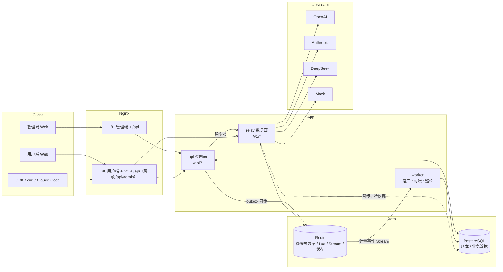
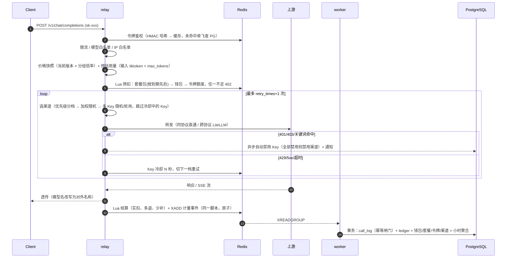
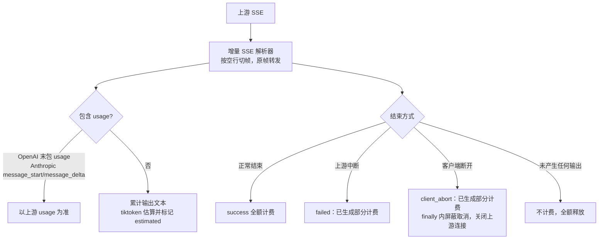

# Token Market 架构说明

> 大模型 API 中转与 Token 经营平台：多厂商统一接入、调用鉴权、输入/输出 Token 计量、按量 + 套餐包计费、额度管控、调用流水、账单对账。

## 1. 定位与取舍

| 决策 | 选择 | 原因 |
|---|---|---|
| 产品形态 | 对标 New API（渠道 / 多 Key / 渠道测试 / 模型广场 / 计费 / 令牌 / 日志 / 钱包 / 兑换码 / 操练场），补齐 **Token 套餐包** 与 **经营对账** | 成熟的商用信息架构；New API 为 AGPL，本项目只复刻功能与交互，代码自研 |
| 网关 | **自研 FastAPI 中转**，LiteLLM 仅作 **SDK** 做跨协议转换 | 渠道 / 令牌 / 额度 / 计费只有一份数据源；LiteLLM Proxy 自带 Key 与模型表会形成双写，且其预算按美元累计，无法表达「套餐包 + 钱包」多桶 Token 额度 |
| 协议适配 | **同协议直通（httpx），跨协议走 LiteLLM** | 直通保真（cache_control、thinking、beta 头原样透传）、延迟最低、usage 自己解析；仅 OpenAI↔Anthropic 互转时依赖 LiteLLM |
| 额度 | **Redis Lua 原子预扣 + PG 只追加账本** | Redis 扛并发与原子性，PG 保证最终正确与可审计 |
| 前端 | React + shadcn/ui，**用户端与管理端两个独立应用** | 管理端可单独部署在内网端口 / 域名 |

## 2. 总体架构



一个代码库 `server/`，三种进程角色：

| 进程 | 职责 | 扩展方式 |
|---|---|---|
| relay | 鉴权、限流、定价、预扣、选渠道、转发、计量、结算 | 无状态，水平扩展 |
| api | 用户端 / 管理端 / 公开接口、支付回调、管理操作 | 无状态，水平扩展 |
| worker | 计量事件落库、outbox 重试、预扣回收、套餐过期、分区预建、渠道巡检、订单超时、账单、对账 | 多实例，周期任务用 Redis 锁互斥；Stream 消费者组天然分摊 |

### 单位约定
- 金额统一为 **整数微元**（1 元 = 1,000,000），全链路整数运算、向上取整，杜绝浮点误差。
- 单价为 **微元 / 百万 token**；套餐包以 **token** 计。

## 3. 核心调用链路



关键代码：`server/app/relay/handler.py`（主链路）、`selector.py`（选渠道）、`upstream.py`（适配器）、`quota/lua/*.lua`（额度）、`billing/usage_writer.py`（落库）。

## 4. 并发额度扣减防超卖

### 4.1 问题
「查余额 → 调上游 → 扣费」三步分离时，N 个并发请求会同时看到同一个余额而全部放行，导致超卖；先调用后扣费还会让单个长请求把余额扣成大额负数。

### 4.2 方案：两阶段（预扣 → 结算），Redis Lua 保证原子性

**预扣**（`reserve.lua`），一个脚本内完成「检查 + 冻结」：
1. 按到期时间升序遍历适用当前模型的套餐包，按各包计量规则（输入权重 / 输出权重）计算所需 token，**部分覆盖**时记录剩余比例 f；
2. 剩余比例 f 换算为钱包金额，校验钱包可用余额与令牌额度上限；
3. **全部校验通过后才落地变更**（套餐余量减少、钱包 bal → frz、令牌额度减少），写入预扣单（含 TTL 与结算上下文）。

**结算**（`settle.lua`）：按实际用量在预扣分配上重放：未用完的退回；超出预扣的部分从可用余额追加，允许透支到 `overdraft_limit`（吸收预估偏差），再超出记 `shortfall` 告警。结算与 `XADD` 计量事件在**同一脚本**中执行，「额度变化」与「待落库事件」要么同时发生、要么都不发生。

预估值 = 输入 token（tiktoken）+ `max_tokens`（缺省取配置值，并受模型最大输出约束），因此正常情况下结算只会退款不会补扣。

### 4.3 热数据与账本一致性

| 机制 | 说明 |
|---|---|
| PG 为最终账本 | `ledger_entry` 只追加，`UNIQUE(biz_type, biz_id, bucket_key)` 幂等；call_log `(request_id, created_at)` 唯一作为落库闸门 |
| 冷启动加载 | Redis 无该用户热数据时从 PG 快照加载（`load.lua`，仅在不存在时写入，并发加载只生效一次） |
| 外部变更（充值 / 兑换 / 调整 / 套餐发放 / 过期） | PG 事务内同时写入：余额或套餐 + 流水 + `wallet.ext_version += 1` + **outbox**；提交后立即投递 Redis（`apply_ext.lua`），失败由 worker 每 5s 重试 |
| 加载与充值竞争 | `apply_ext` 只应用 `ver > 加载版本(lver)` 的变更，并用 op 集合去重，防止「加载快照已包含 + 又增量一次」的重复入账 |
| 余额购买 | 先在 Redis 冻结金额（与进行中的调用互斥），PG 记账后同步、再解冻 |
| 卡死的预扣 | 预扣单 TTL = 2×回收期限；worker 扫描到期的预扣，按预估值保守结算并标记 `reaped` 供复核 |
| Redis 故障 | `pg_fallback`：改用 `UPDATE wallet SET balance = balance - :x WHERE balance >= :x` 条件扣减（原子、不超卖），PG 余额变化写 outbox，Redis 恢复后同步；或配置 `fail_closed` 直接拒绝 |

### 4.4 实测（`make bench`）

| 场景 | 结果 |
|---|---|
| 余额 ¥1，300 并发各预扣 ¥0.01，**先查后扣** | 成功 300 笔，超卖 200 笔，余额 **-¥2.00** |
| 同上，**Lua 原子预扣** | 成功 **100** 笔，超卖 0，余额 ¥0.00 |
| 端到端：余额 ¥0.002，500 并发流式请求经 Nginx → relay | 成功 15、402 拒绝 485、其他 0；余额未为负；Redis = PG = 流水；三项对账全部一致 |

## 5. 流式请求的 Token 统计



要点：
1. **主动索取 usage**：OpenAI 兼容请求注入 `stream_options.include_usage=true`；若客户端本身未要求，则吞掉仅含 usage 的末包，对客户端完全透明。Anthropic 从 `message_start`（input / cache_read / cache_creation）与 `message_delta`（累计 output）取值。
2. **兜底估算**：上游未返回 usage 时，输入沿用预估值，输出按实际文本计数，`usage_estimated=true` 写入流水，便于对账区分。
3. **断开即结算**：客户端断开时 StreamingResponse 的生成器被取消，`finally` 中用 `anyio.CancelScope(shield=True)` 确保「关闭上游连接 + 结算」一定执行，避免上游继续生成产生成本。
4. **三层保障**：流结束 finally 结算 → 结算失败由预扣 TTL 回收任务兜底 → 落库失败由 Stream 消费者组重试、死信告警。
5. **计费策略**：已生成的内容照常计费（上游同样按已生成向平台收费）；未产生任何输出的失败不计费。

实测（`make fault`）：客户端读取 10 个分片后断开 → `client_abort` 按已生成计费、冻结释放；上游截断 → `failed` 按已生成计费；上游无 usage → `estimated`。

## 6. 计费模型

| 维度 | 设计 |
|---|---|
| 价格 | 模型 × 版本：输入 / 输出 / 缓存读 / 缓存写（元 / 百万 token）或按次；**新增版本而非修改**，可设未来生效时间实现定时调价；调用时快照，历史账单可追溯 |
| 分时计价 | 价格版本可带时段规则（星期、起止、时区、倍率），按**请求开始时刻**命中第一条并写入快照；DeepSeek 默认低谷价为基础价、工作日高峰 ×2。渠道成本默认跟随售价时段，也可配置独立的采购时段规则 |
| 分组 | `price_ratio` 调用折扣、`topup_ratio` 充值倍率、`usable_groups` 令牌可选分组 |
| 按量 | 预充值钱包，按售价实时扣减 |
| 套餐包 | 「多少钱买多少 token」：适用范围（全部 / 指定模型 / 指定供应商）、有效期、每人限购、输入/输出计量权重（如输出按 4 倍计）；**同一请求先扣套餐（按到期先后），不足部分按比例走钱包** |
| 令牌额度 | 单个 API Key 的钱包消费上限，与账户余额同时校验 |
| 成本 | 渠道 `cost_ratio`（采购价相对售价原价的倍率），每笔调用记录成本，看板输出毛利 |

## 7. 渠道路由与健康

- **能力表** `ability(group, model, channel)`：渠道保存时重建，数据面常驻内存，控制面变更后通过 Redis 版本号秒级失效。
- **选择**：最高优先级档内加权随机（权重 +10 基数）→ 多 Key 随机或轮询（Redis INCR）→ 跳过冷却中的 Key；第 N 次重试降到第 N 档。
- **自动禁用**：状态码（默认 401/403）或错误关键词（insufficient_quota、invalid_api_key、余额不足等）命中 → 禁用该 Key；渠道 Key 全部不可用则禁用渠道；通知管理员。
- **自动恢复**：单个 / 批量 / 定时测试成功后恢复「自动禁用」的渠道与 Key（手动禁用不动）。
- **冷却**：429 / 5xx 后 Key 冷却 N 秒，避免雪崩重试。

## 8. 流水、账单与对账

| 数据 | 说明 |
|---|---|
| `call_log` | 每次调用一条，按月 RANGE 分区（默认分区兜底，worker 预建后续 2 个月）；含 token、估算标记、售价、钱包扣费、套餐扣减、成本、价格快照、首字 / 总耗时、重试次数 |
| `ledger_entry` | 所有资金与套餐变动，只追加；钱包与每个套餐实例各为一个「桶」 |
| `usage_hourly` | 小时 × 用户 × 令牌 × 渠道 × 模型 聚合，支撑看板与账单 |
| `statement` | 日 / 月账单，周期结束后生成且不可变（期初、期末、充值、消费、退款、套餐抵扣、分模型明细） |
| `order` | 下单 → 收银台 → 网关签名回调 → 验签 → 行锁 + 状态 CAS 幂等发货；已收款发货失败停留 `paid`，管理员补发货 |

**对账**（worker 每小时 + 管理端一键）：
1. 钱包余额 = 钱包流水之和；套餐剩余 = 套餐流水之和；
2. 调用流水的钱包 / 套餐扣减 = 对应 `consume` 流水（逐笔）；
3. Redis 热数据（可用 + 冻结）= PG 余额（仅在计量流无积压、无待同步 outbox 时比对），差异可一键重建；
4. **与厂商对账**（管理端「上游对账」）：
   - 账单比对：按渠道导入厂商用量账单 CSV，与平台按「对账时区日期 × 上游模型」聚合的请求数、输入/输出 token、渠道成本逐行比对，超过容差（默认 1%）标记差异，识别「仅平台有 / 仅上游有」；
   - 余额快照：对有余额接口的厂商（DeepSeek）每小时记录余额，两次快照之间余额减少量 = 上游实际扣费，与平台同一时间窗内核算的渠道成本比对。

## 9. 风险点与兜底策略

| 风险 | 兜底 |
|---|---|
| 并发超卖 | Lua 原子预扣；余额购买先冻结；压测验证 |
| Redis 宕机 | PG 条件扣减降级（或 fail_closed）；outbox 恢复后同步；对账核验 |
| Redis 数据丢失 | AOF everysec + noeviction；丢失后从 PG 快照重建（最多损失 1s 内未落库的计量，由对账发现） |
| 结算 / 落库失败 | 结算与事件原子写入；消费者组重领、10 次失败入死信并告警；预扣 TTL 回收 |
| 重复扣费 / 重复发货 | request_id / order_no / biz_id 唯一约束；订单 `SELECT … FOR UPDATE` + 状态判断；兑换码 CAS |
| 支付回调伪造 / 篡改 | HMAC 签名校验、金额比对，不一致拒绝发货 |
| 调用中途调价 | 预扣时价格快照，结算沿用快照 |
| Token 估算偏差 | 以上游 usage 为准；透支上限吸收偏差；`estimated` 标记供对账 |
| 客户端断流 | 屏蔽取消的 finally：关闭上游 + 按已生成结算 |
| 上游故障 / 限流 | 分档重试、Key 冷却、自动禁用 + 定时巡检自动恢复 |
| 上游 Key 失效或欠费 | 状态码 / 关键词自动禁用，通知管理员；DeepSeek 余额查询 |
| 缓存击穿打满连接池 | 鉴权单飞合并；按进程分配连接池预算；PG max_connections=300 |
| API Key 泄露 | 只存 HMAC 哈希（创建时展示一次）、IP 白名单、模型白名单、额度上限、RPM 限制，可随时禁用 |
| 渠道 Key 泄露 | AES-256-GCM 加密存储，接口与日志只返回掩码 |
| SSRF（自定义 base_url） | 生产环境仅允许 https，解析到内网地址拒绝，白名单放行 |
| 管理端暴露 | 管理接口仅在 81 端口暴露（80 端口屏蔽 `/api/admin`），所有管理操作写审计日志 |
| 账实不符 | 三类自动对账 + 差异报告 + 一键重建 |
| LiteLLM 升级破坏行为 | 锁定版本；同协议直通不依赖 LiteLLM；跨协议路径保留回归测试 |
| 依赖供应链 | pnpm 12 最小发布时长策略（拒绝 24h 内发布的包），锁定 pnpm 版本 |

## 10. 安全

- 用户密码 argon2；JWT 携带 `auth_version`，改密 / 禁用 / 改角色即刻失效；登录失败限流。
- 角色：user / admin / root，敏感操作（系统设置、改角色、重建额度）仅 root。
- 公开接口不暴露上游渠道信息；上游 401/403 对用户统一返回 503，不泄露平台 Key 状态。

## 11. 容量与部署

- Nginx：`worker_connections 16384`（每个流式请求占 2 个连接）、`/v1` 关闭缓冲、900s 读超时。
- 连接池预算：`Σ 进程数 × (TM_DB_POOL_SIZE + TM_DB_MAX_OVERFLOW) < max_connections`，compose 中按角色设置。
- 进程数：`API_WORKERS` / `RELAY_WORKERS` 建议等于 CPU 核数；relay 每进程约 250MB。
- 说明：当前开发机 Docker Desktop 仅分配 1 CPU / 2GB，容器内吞吐不具参考意义；功能与一致性已在 500 并发下验证。

## 12. 演示

```bash
make up            # docker compose 全栈（镜像源异常时：DOCKER_BUILDKIT=0 make up）
make bench         # 防超卖：naive vs Lua + 端到端 500 并发 + 对账
make fault         # 故障注入：断流 / 截断 / 无 usage / 500 重试 / 401 自动禁用
make fault-redis   # 追加 Redis 宕机降级与恢复
make test          # 后端测试（额度引擎、支付回调幂等、兑换码并发）
```

| 入口 | 地址 | 账号 |
|---|---|---|
| 用户端 / 公开站 / API | http://localhost:8080 | 注册或 alice / Alice12345!（演示数据） |
| 管理端 | http://localhost:8081 | root / ChangeMe123!（`.env` 中修改） |

## 13. 已知限制与规划

- 周期订阅、邀请返利 / 签到、OAuth / 2FA、绘图 / 视频异步任务、OpenAI Responses API、真实支付宝 / 微信接入、ClickHouse 日志。
- OpenAI / Anthropic 用量 Admin API 自动拉取账单；时段规则支持法定节假日。
- 结算超出预扣时目前允许透支吸收，尚未实现流式过程中的实时截断。
